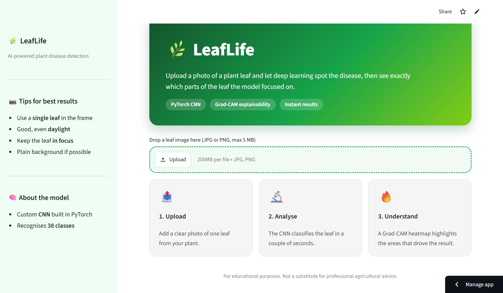

# 🌿 LeafLife

**AI-powered plant disease detection with explainable predictions.**

Upload a photo of a plant leaf and LeafLife classifies the disease using a custom convolutional neural network built in PyTorch. It also produces a **Grad-CAM heatmap** that highlights the regions of the leaf that influenced the prediction, so the result is not a black box.


## 🔗 Live Demo

**[Try LeafLife on Streamlit](https://leaflife.streamlit.app)**

> Free hosting puts apps to sleep when idle. If you see a "wake this app up" button, click it and wait a moment.

<!-- Replace the link above with your real Streamlit URL, then add screenshots/GIF below -->

## 📸 Screenshots

| Upload | Prediction + Grad-CAM |
|---|---|
|  |  |

<!-- Add a short demo GIF or video link here -->

## ✨ Features

- **Disease classification** from a single leaf photo using a custom 5-block CNN
- **Explainability with Grad-CAM**: a heatmap overlay shows what the model focused on
- **Two interfaces**: a Streamlit app for quick use, and a full-stack version (React + FastAPI)
- **Input validation**: JPG/PNG only, 5 MB size limit, and protection against oversized (decompression-bomb) images
- **CPU-friendly**: runs on a free CPU instance, with a single-thread setup and a lock around Grad-CAM for safe concurrent use
- **Configurable CORS** through an environment variable

## 🧠 How It Works

1. The image is validated, converted to RGB and resized.
2. It is resized to 224×224 and normalised using the mean and standard deviation saved with the model.
3. The CNN predicts the most likely class.
4. Grad-CAM computes gradients for the predicted class at the last convolutional layer, builds a heatmap, and overlays it on the original image.

### Model architecture

A custom CNN with five convolutional blocks followed by a classifier head.

| Stage | Details |
|---|---|
| Conv block 1 | Conv(3→32) + BatchNorm + ReLU + MaxPool |
| Conv block 2 | Conv(32→64) + BatchNorm + ReLU + MaxPool |
| Conv block 3 | Conv(64→128) + BatchNorm + ReLU + MaxPool |
| Conv block 4 | Conv(128→256) + BatchNorm + ReLU + MaxPool |
| Conv block 5 | Conv(256→512) + BatchNorm + ReLU + MaxPool |
| Classifier | Flatten → Linear(25088→512) → ReLU → Dropout(0.5) → Linear(512→num_classes) |

Input size: 224×224×3. Grad-CAM targets the convolutional layer in block 5.

### Model results

<!-- Fill in with your real numbers, for example: -->
- **Dataset:** _add dataset name and source_
- **Number of classes:** _add number_
- **Validation accuracy:** _add value_

## 🛠 Tech Stack

| Area | Tools |
|---|---|
| Model | PyTorch, torchvision |
| Image processing | Pillow, OpenCV (headless), NumPy |
| Backend API | FastAPI, Uvicorn |
| Web app | Streamlit |
| Frontend | React (Vite) |
| Hosting | Streamlit Community Cloud, Vercel (frontend) |

## 📁 Project Structure

```
LeafLife/
├── .streamlit/
│   └── config.toml          # Streamlit theme
├── app.py                   # Streamlit app
├── main.py                  # FastAPI backend
├── model_utils.py           # Inference wrapper + heatmap encoding
├── Predict_Image.py         # CNN definition, model loading, Grad-CAM
├── requirements.txt
├── leaf_disease_model.pth   # Trained model checkpoint
└── frontend/                # React (Vite) frontend
```

> Adjust the tree above if your files live in different folders.

## 🚀 Getting Started

### Prerequisites

- Python 3.10 to 3.14
- Node.js 18+ (only for the React frontend)

### 1. Clone and install

```bash
git clone https://github.com/YOUR-USERNAME/LeafLife.git
cd LeafLife

python -m venv venv
# Windows
venv\Scripts\activate
# macOS / Linux
source venv/bin/activate

pip install -r requirements.txt
```

The requirements install the **CPU build** of PyTorch, which keeps the install small.

> **Windows tip:** if you get a "filename or extension is too long" error, either enable long paths in Windows or create your virtual environment in a short path such as `D:\lf_env`.

### 2a. Run the Streamlit app

```bash
streamlit run app.py
```

Open `http://localhost:8501`.

### 2b. Run the FastAPI backend

```bash
uvicorn main:app --reload --port 8000
```

- Health check: `http://localhost:8000/`
- Interactive docs: `http://localhost:8000/docs`

Allow your frontend origin through CORS (defaults to `http://localhost:5173`):

```bash
# macOS / Linux
export ALLOWED_ORIGINS="http://localhost:5173,https://your-site.vercel.app"
# Windows PowerShell
$env:ALLOWED_ORIGINS="http://localhost:5173,https://your-site.vercel.app"
```

### 3. Run the React frontend

```bash
cd frontend
npm install
```

Create `frontend/.env.local`:

```
VITE_API_URL=http://localhost:8000
```

Then:

```bash
npm run dev
```

## 📡 API Reference

### `GET /`

Health check.

```json
{ "status": "ok", "num_classes": 38 }
```

*(`num_classes` depends on your model.)*

### `POST /predict`

Send an image as `multipart/form-data` with the field name `file`.

| Rule | Value |
|---|---|
| Formats | JPG, PNG |
| Max size | 5 MB |
| Max dimensions | 25 megapixels |

**Example**

```bash
curl -X POST "http://localhost:8000/predict" -F "file=@leaf.jpg"
```

**Response**

```json
{
  "disease": "Class name",
  "heatmap": "data:image/jpeg;base64,..."
}
```

| Status | Meaning |
|---|---|
| 400 | Unsupported type, corrupted image, or dimensions too large |
| 413 | File larger than 5 MB |
| 500 | Prediction failed |

## ☁️ Deployment

### Streamlit Community Cloud (recommended)

1. Push the repo to GitHub (public), including `leaf_disease_model.pth`.
2. Go to [share.streamlit.io](https://share.streamlit.io) and sign in with GitHub.
3. Click **Create app**, choose the repo and branch, and set the main file to `app.py`.
4. In **Advanced settings**, pick Python 3.12, then deploy.

### Full-stack (optional)

- **Frontend:** deploy the `frontend` folder on [Vercel](https://vercel.com) and set `VITE_API_URL` to your backend URL.
- **Backend:** run the FastAPI app on any host that supports Python and has enough memory for PyTorch. Set `ALLOWED_ORIGINS` to your frontend URL.

## ⚠️ Limitations

- Trained on a specific set of plants and diseases, so it will not recognise anything outside its training classes.
- Works best with a single, well-lit, in-focus leaf against a plain background.
- Predictions are for **educational purposes** and are not a substitute for professional agricultural advice.

## 🔮 Future Improvements

- Show confidence scores and top-3 predictions
- Add treatment and prevention tips for each disease
- Support more plant species and field-condition images
- Export the model to ONNX for faster, lighter inference

## 👤 Author

**Abdullah Yaqoob**

- GitHub: [@MirzaAbdullah413](https://github.com/MirzaAbdullah413)
- LinkedIn: www.linkedin.com/in/muhammad-abdullah-0073aa336
